<a href="https://wardkeadan.vercel.app"><picture><source media="(prefers-color-scheme: dark) and (max-width: 600px)" srcset="assets/hero-mobile-dark.svg"><source media="(max-width: 600px)" srcset="assets/hero-mobile-light.svg"><source media="(prefers-color-scheme: dark)" srcset="assets/hero-dark.svg"></picture></a>

<a href="https://wardkeadan.vercel.app"><picture><source media="(prefers-color-scheme: dark)" srcset="assets/btn-portfolio-dark.svg"></picture></a>&nbsp;<a href="https://www.linkedin.com/in/ward-keadan"><picture><source media="(prefers-color-scheme: dark)" srcset="assets/btn-linkedin-dark.svg"></picture></a>&nbsp;<a href="mailto:wardkadan1@gmail.com"><picture><source media="(prefers-color-scheme: dark)" srcset="assets/btn-email-dark.svg"></picture></a>

I build web applications end to end — REST APIs, data models and React / Next.js interfaces — and I'm just as comfortable below the software stack: I've designed a microcoded CPU in VHDL and written register-level firmware for AVR. I hold a B.Sc. in Computer Science from the Holon Institute of Technology (2025).

I use AI-assisted workflows (Claude Code, Cursor) for implementation, code review and debugging, and I treat their output the way I treat a teammate's pull request: read it, test it, question it.

<picture><source media="(prefers-color-scheme: dark) and (max-width: 600px)" srcset="assets/divider-experience-mobile-dark.svg"><source media="(max-width: 600px)" srcset="assets/divider-experience-mobile-light.svg"><source media="(prefers-color-scheme: dark)" srcset="assets/divider-experience-dark.svg">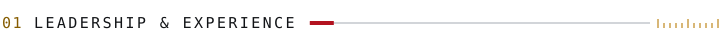</picture>

### Team Lead · Talent Bridge
**Hasoub AI Engineer Career Accelerator** · 2026 – present · team of five

A recruitment and career-support platform for Hasoub, with separate portals for candidates, recruiters and senior engineers. React + TypeScript frontend, FastAPI backend, PostgreSQL, Docker. I joined as the team's Scrum Master and now lead it as Team Lead.

- **Technical coordination** — breaking work down, aligning frontend and backend, keeping the team unblocked
- **Pull request reviews** — reviewing changes for correctness, consistency and maintainability
- **Workflow** — improving how the team uses GitHub and Jira, from issues to merged PRs
- **Quality** — pushing automated testing and code quality (pytest, Vitest, GitHub Actions)
- **AI-assisted collaboration** — bringing Claude Code into day-to-day engineering, with review on every change

**Also** — building the *Elafandy B2B Platform* solo for a real wholesale business (Next.js, PostgreSQL, Prisma; in progress), and earlier co-founded *BuilderBond*, a construction-labor marketplace, as co-founder and frontend developer — presented at HIT FUTURE Demo Day.

<picture><source media="(prefers-color-scheme: dark) and (max-width: 600px)" srcset="assets/divider-stack-mobile-dark.svg"><source media="(max-width: 600px)" srcset="assets/divider-stack-mobile-light.svg"><source media="(prefers-color-scheme: dark)" srcset="assets/divider-stack-dark.svg">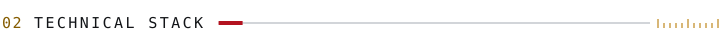</picture>

<picture><source media="(prefers-color-scheme: dark) and (max-width: 600px)" srcset="assets/stack-mobile-dark.svg"><source media="(max-width: 600px)" srcset="assets/stack-mobile-light.svg"><source media="(prefers-color-scheme: dark)" srcset="assets/stack-dark.svg">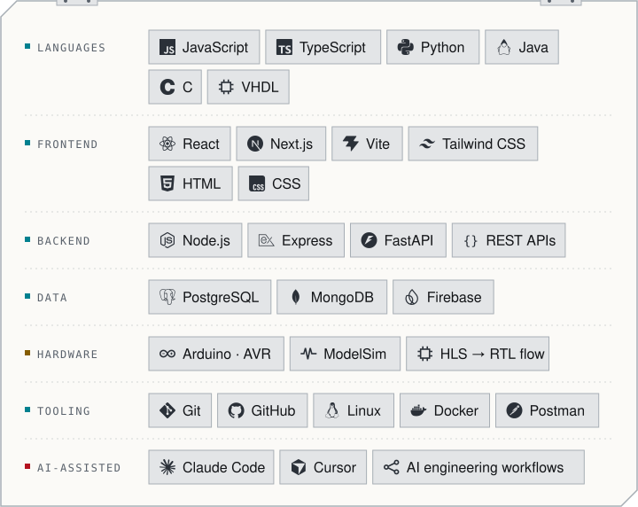</picture>

<picture><source media="(prefers-color-scheme: dark) and (max-width: 600px)" srcset="assets/divider-projects-mobile-dark.svg"><source media="(max-width: 600px)" srcset="assets/divider-projects-mobile-light.svg"><source media="(prefers-color-scheme: dark)" srcset="assets/divider-projects-dark.svg">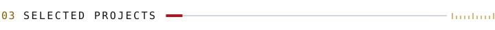</picture>

<a href="https://github.com/wardkadan1/Code-Review-Roulette"><picture><source media="(prefers-color-scheme: dark) and (max-width: 600px)" srcset="assets/card-code-review-roulette-mobile-dark.svg"><source media="(max-width: 600px)" srcset="assets/card-code-review-roulette-mobile-light.svg"><source media="(prefers-color-scheme: dark)" srcset="assets/card-code-review-roulette-dark.svg">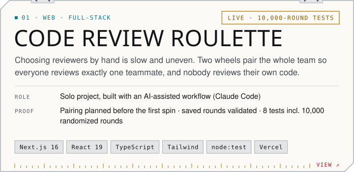</picture></a>

<a href="https://github.com/wardkadan1/Code-Review-Roulette">Repository ↗</a> &nbsp;·&nbsp; <a href="https://code-review-roulette-five.vercel.app">Live demo ↗</a>

 

<a href="https://github.com/wardkadan1/Harmony-Headlines"><picture><source media="(prefers-color-scheme: dark) and (max-width: 600px)" srcset="assets/card-harmony-headlines-mobile-dark.svg"><source media="(max-width: 600px)" srcset="assets/card-harmony-headlines-mobile-light.svg"><source media="(prefers-color-scheme: dark)" srcset="assets/card-harmony-headlines-dark.svg">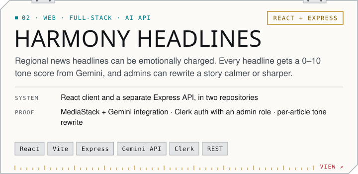</picture></a>

<a href="https://github.com/wardkadan1/Harmony-Headlines">Frontend ↗</a> &nbsp;·&nbsp; <a href="https://github.com/wardkadan1/Harmony-Headlines-Backend">Backend API ↗</a>

 

<a href="https://github.com/wardkadan1/Cost-Manager-RESTful-Web"><picture><source media="(prefers-color-scheme: dark) and (max-width: 600px)" srcset="assets/card-cost-manager-mobile-dark.svg"><source media="(max-width: 600px)" srcset="assets/card-cost-manager-mobile-light.svg"><source media="(prefers-color-scheme: dark)" srcset="assets/card-cost-manager-dark.svg">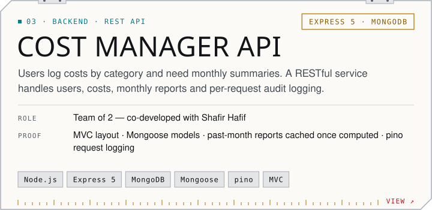</picture></a>

<a href="https://github.com/wardkadan1/Cost-Manager-RESTful-Web">Repository ↗</a>

 

<a href="https://github.com/wardkadan1/CPU-16-8-16"><picture><source media="(prefers-color-scheme: dark) and (max-width: 600px)" srcset="assets/card-cpu-16-8-16-mobile-dark.svg"><source media="(max-width: 600px)" srcset="assets/card-cpu-16-8-16-mobile-light.svg"><source media="(prefers-color-scheme: dark)" srcset="assets/card-cpu-16-8-16-dark.svg">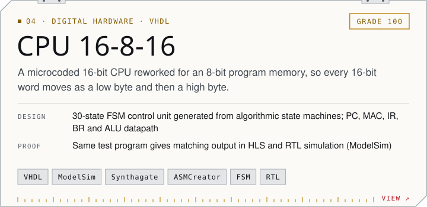</picture></a>

<a href="https://github.com/wardkadan1/CPU-16-8-16">Repository ↗</a>

 

<a href="https://github.com/wardkadan1/iot-project"><picture><source media="(prefers-color-scheme: dark) and (max-width: 600px)" srcset="assets/card-parking-gate-mobile-dark.svg"><source media="(max-width: 600px)" srcset="assets/card-parking-gate-mobile-light.svg"><source media="(prefers-color-scheme: dark)" srcset="assets/card-parking-gate-dark.svg">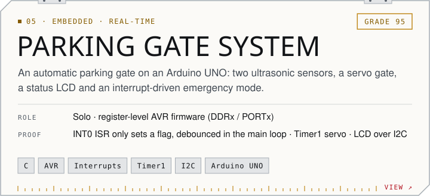</picture></a>

<a href="https://github.com/wardkadan1/iot-project">Repository ↗</a>

 

More: [SmartInventory](https://github.com/wardkadan1/SmartInventory) — Android (Java) with Firebase Auth and Firestore · [Who Is The Smartest?](https://github.com/wardkadan1/Who-Is-The-Smartest) — trivia game built by a team of four

<picture><source media="(prefers-color-scheme: dark) and (max-width: 600px)" srcset="assets/divider-contact-mobile-dark.svg"><source media="(max-width: 600px)" srcset="assets/divider-contact-mobile-light.svg"><source media="(prefers-color-scheme: dark)" srcset="assets/divider-contact-dark.svg">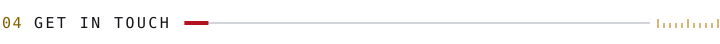</picture>

Open to **software engineering roles** — full-stack and backend first, and also AI-related software engineering, embedded systems and verification.

<a href="https://wardkeadan.vercel.app"><picture><source media="(prefers-color-scheme: dark)" srcset="assets/btn-portfolio-dark.svg"></picture></a>&nbsp;<a href="https://www.linkedin.com/in/ward-keadan"><picture><source media="(prefers-color-scheme: dark)" srcset="assets/btn-linkedin-dark.svg"></picture></a>&nbsp;<a href="mailto:wardkadan1@gmail.com"><picture><source media="(prefers-color-scheme: dark)" srcset="assets/btn-email-dark.svg"></picture></a>

